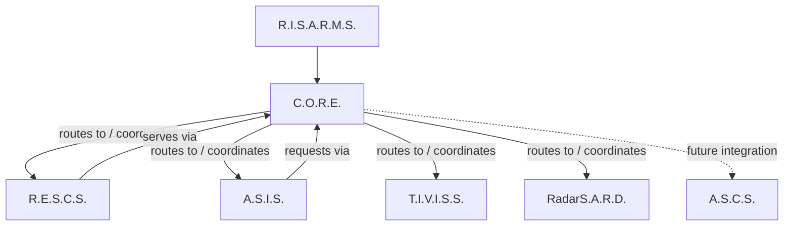

# R.I.S.A.R.M.S. — Architecture & Documentation

> [!NOTE] **Repository role:** This repository is the **architectural source of truth** for the R.I.S.A.R.M.S. ecosystem. It describes what each system is, what it owns, how the systems interact, and what is and is not implemented today. The actual subsystem repositories are the implementation source of truth.

---

## 1. What is R.I.S.A.R.M.S.?

**R.I.S.A.R.M.S.** stands for **R**ishik's **I**ntelligent **S**mart **A**dministration and **R**esource **M**anagement **S**ystem.

R.I.S.A.R.M.S. is the name for the *entire ecosystem* — not a single program. It is a set of modular systems that are independently developed but designed to operate as one coherent whole.

The ecosystem is composed of six systems plus a unified desktop application:

| System | Expansion | Role |
|---|---|---|
| **C.O.R.E.** | Communication, Organization and Resource Engine | Central management, communication, routing and control engine |
| **R.E.S.C.S.** | Rishik's Efficient System for Cloud Storage | Cloud-backed data and file storage |
| **A.S.I.S.** | A Smart Intelligence System | Primary AI / intelligence layer |
| **T.I.V.I.S.S.** | Though I'm Vanquished, I'm Still Stronger | Separate AI agent, designed for eventual handover to another person |
| **RadarS.A.R.D.** | Radar Security, Anomaly Reconnaissance Device | Security and anomaly detection |
| **A.S.C.S.** | A Smart Coding System | Local autonomous coding agent (currently standalone) |

## 2. What this repository contains

This repository is the documentation home of the ecosystem. It contains:

- **Architecture** — the overall design, boundaries, interactions, data flow and lifecycle ([`architecture/`](architecture/overview.md))
- **Per-system reference** — what each system does and owns ([`systems/`](systems/))
- **Interface contracts** — required fields and behavior of communication, messaging, routing, services and integration ([`interfaces/`](interfaces/communication.md))
- **Security architecture** — identity, authentication, authorization and trust boundaries ([`security/`](security/overview.md))
- **Development guidance** — roadmap, versioning, testing and contribution policy ([`development/`](development/roadmap.md))
- **Cross-platform release engineering** — per-repo commands, manifests, release pipelines, artifact naming and validation levels ([`development/cross-platform-release.md`](development/cross-platform-release.md))
- **Architecture Decision Records** — the reasoning behind important architectural choices ([`decisions/`](decisions/README.md))

## 3. Ecosystem architecture



The arrows are explained precisely in [System Interactions](architecture/system-interactions.md). The intent is: **all cross-system communication flows through C.O.R.E.**, and C.O.R.E. is the layer that coordinates, routes and manages the ecosystem. An arrow does **not** mean the communication path exists today — statuses are stated per edge.

## 4. Each subsystem at a glance

- **C.O.R.E.** is the central control engine. It owns communication, message protocols, routing, organization, resources, services, runtime/lifecycle, events, dependencies, configuration, health, logging and security infrastructure. It is **not** the primary AI. CORE 0.6.0 server releases target **Void Linux x86_64 glibc with runit; HP 14 is the reference deployment machine**; Windows, macOS, Raspberry Pi/ARM64 and systemd server deployments are historical or unsupported for this release. RISARMS-ui remains the supported desktop client. The canonical target is documented in [Void Linux host](development/void-linux.md). → [systems/core.md](systems/core.md)
- **R.E.S.C.S.** is the cloud/data storage system: persistent records, file/object storage, retrieval, lifecycle/governance and cloud-backed data. It is an **independent project** (`RESCS/` next to `CORE-HOST/`); `RISARMS-HOST/services/RESCS/` is a release mirror. → [systems/rescs.md](systems/rescs.md)
- **A.S.I.S.** is the primary AI/intelligence layer: natural-language understanding, reasoning, response generation and voice. It is an **independent project** (`ASIS/` next to `CORE-HOST/`). It uses C.O.R.E. (and storage through C.O.R.E.) rather than owning C.O.R.E. responsibilities. → [systems/asis.md](systems/asis.md)
- **T.I.V.I.S.S.** is a separate AI agent with its own identity, configuration, memory, permissions and ownership model — intended to eventually be handed over to another person. It must **not** become a renamed copy of A.S.I.S. Its v0.2.0 foundation lives locally at `TIVISS-HOST/` and remains foundation-only (no live traffic, no real handover). → [systems/tiviss.md](systems/tiviss.md)
- **RadarS.A.R.D.** is the security/anomaly sensor layer. It detects and reports; C.O.R.E. coordinates the resulting events, logging, health state and responses. → [systems/radar-sard.md](systems/radar-sard.md)
- **A.S.C.S.** is a local autonomous coding agent (multi-provider: Ollama, OpenAI, Anthropic, Grok, Google, DeepSeek — LiteLLM/OpenCode opt-in). It is fully implemented as a **standalone** tool (`requires_core: false`) on Windows/macOS/Linux x86_64+arm64, Python 3.12+, with **optional** C.O.R.E. integration (protocol 0.3.0/0.4.0 via `ASCS_CORE_CREDENTIAL` / `ASCS_CORE_ENABLED`, offline fallback) and a Linux/Pi headless generation-only path; full A.S.I.S./T.I.V.I.S.S. integration through C.O.R.E. remains future intent. → [systems/asc.md](systems/asc.md)
- **RISARMS-UI** is the canonical cross-platform desktop application. It presents C.O.R.E., ASIS, ASCS, RESCS and TIVISS, keeps local profiles/history/records/files usable offline, and consumes CORE-HOST over HTTPS/WSS. It is a presentation client, not a new integration layer. → [systems/risarms-ui.md](systems/risarms-ui.md)

## 5. Current development status

> [!NOTE] **Status vocabulary:** The ecosystem uses four explicit statuses throughout these documents: **IMPLEMENTED**, **IN DEVELOPMENT**, **PLANNED**, **FUTURE**. Definitions are in [Architecture Overview](architecture/overview.md#3-status-vocabulary).

| System | Status | Notes |
|---|---|---|
| **C.O.R.E.** | v0.6.0 **IMPLEMENTED** (beta source) | Void Linux x86_64 glibc/runit server release (HP 14-dq1037wm is the reference deployment machine, not a hardware gate), with versioned virtual environments, storage guard, Caddy/nftables, svlogd rotation, backup/restore, upgrade/rollback and diagnostics. Protocol remains 0.4.0. Verified: 917 host tests passed / 4 skipped and 225 client tests passed / 1 skipped (macOS Python 3.14, 2026-11-22); CORE-HOST CI green on Python 3.10–3.14 plus the full Windows job. Server releases are assembled and published by **RISARMS-HOST** from pinned component commits — CORE-HOST only runs test CI. Void install/reboot/rollback/storage-failure and physical HP validation remain **NOT YET PERFORMED**. Physical LAN target (Void CORE host ↔ RISARMS-ui on macOS Intel, macOS Apple Silicon, Windows x86_64, Linux x86_64) is **NOT YET PERFORMED**. Installed RAM on the HP is unverified (earlier report: 4 GB; a 16 GB upgrade is PLANNED). Windows, macOS, Pi/ARM64 and systemd server deployments are historical. |
| **RISARMS-UI** | v0.6.0 **IMPLEMENTED** (source) | Canonical Tkinter desktop app with local profiles, offline SQLite store, keychain device credentials, explicit record/file sync, ASIS/ASCS/TIVISS workspaces, owner administration, loopback local-action approvals, signed update checks, verified update download, PyInstaller/native installer packaging and draft-only release validation. Verified: **286 UI tests passed**. Physical Apple Silicon, Windows, Linux and Void smoke runs, signed/notarized installers and public signed auto-updates remain **NOT YET PERFORMED** or gated. iOS TestFlight and Android beta are future work. |
| **R.E.S.C.S.** | v0.4.0 **IMPLEMENTED** | Pi storage foundation: signed CORE owner scope (`X-RESCS-Signature`), required `/srv/core` mount guard, systemd/installer, real CORE loopback validation. Verified: 318 passed / 4 skipped. Live PostgreSQL/Supabase, real S3, deployed C.O.R.E. ↔ R.E.S.C.S. interop, and real Pi/ARM64 remain external validation. The local 0.3.1 line is archived separately; namespace/key uniqueness is unchanged. |
| **A.S.I.S.** | **IN DEVELOPMENT** | Rebuilt `asis` package with Pi policy/worker/handoff support. Verified: 948 passed / 24 skipped (macOS Python 3.12). **ASCS integration IMPLEMENTED** via `ascs_integration` toolset (subprocess + API modes), `ascs_handover`, `ascs_status` — direct local-tool exception documented in ADR 0007; C.O.R.E.-mediated path is FUTURE. C.O.R.E. uplink optional; R.E.S.C.S. future. |
| **T.I.V.I.S.S.** | **IN DEVELOPMENT** (v0.2.0) | v0.2.0 capabilities: **OllamaProvider** (real Ollama HTTP API with streaming, tool calling, thinking tag stripping), **SQLiteMemoryStore** (dual DB: `conversation_logs.db` + `semantic_memory.db`), Web/Calculator/Translation/Voice config mirroring ASIS. Foundation (identity, ownership, runtime, memory, permissions, handover). Verified: 299 passed. Local clone at `TIVISS-HOST/`; real handover intentionally not implemented. |
| **RadarS.A.R.D.** | **PLANNED / FUTURE** | No code exists anywhere. |
| **A.S.C.S.** | **IMPLEMENTED** (standalone) | v0.3.0 coding agent, **standalone** (`requires_core: false`), Python 3.12+, Windows/macOS/Linux x86_64+arm64, multi-provider (ollama, openai, anthropic, grok, google, deepseek; LiteLLM/OpenCode opt-in). **C.O.R.E. integration DECLARED, NOT IMPLEMENTED**: `compatibility.json` marks it optional (protocol 0.3.0/0.4.0, `ASCS_CORE_CREDENTIAL` / `ASCS_CORE_ENABLED`) but no runtime client code exists — ASCS runs standalone with offline fallback. Evidence: 996 passed / 16 skipped (macOS Python 3.14, recorded 2026-11-15, re-verified 2026-11-20). Desktop UI/TUI runtime remains Windows-primary; Pi mode has no tools or TUI. **ASIS integration IMPLEMENTED**: `export_handover_state()` for session continuity — direct local-tool exception in ADR 0007; C.O.R.E.-mediated use is future intent. |

The authoritative per-system detail is in [`systems/`](systems/). **Nothing in this repository describes unbuilt functionality as implemented.**

### Documentation update log

- **2026-11-20** — Void host docs corrected: `python3-venv` → `python3-pip` (Void has no `python3-venv` package; installer uses `python3 -m venv --without-pip` + `python3 -m pip --python …`); installed HP RAM stated as **unverified** (earlier report: 4 GB) with the 2 × 8 GB Samsung DDR4-2666 → 16 GB upgrade **PLANNED, not installed**; HP 14-dq1037wm reworded as the **reference deployment machine** (not a hardware gate); broken `../../CORE/...` links replaced with GitHub URLs (`deployment/void/README.md` currently on `feat/desktop-control-channel`, moves to `main` after merge); LAN target matrix updated to **physical Void CORE host ↔ RISARMS-ui clients (macOS Intel, macOS Apple Silicon, Windows x86_64, Linux x86_64) — NOT YET PERFORMED** (historical Windows-host ↔ Mac tests keep their dates/context); ASCS docs aligned to `ASCS/compatibility.json` + `ASCS/README.md` (multi-provider, cross-platform, standalone, CORE integration declared in the manifest only, Python 3.12+).
- **2026-11-20 — CI fixes (CORE + RESCS), pushed and green.** CORE had three stacked Windows failures, each root-caused and fixed: (1) `test_deployment_scripts_are_executable_and_parse` asserted `S_IXUSR`, which Windows checkouts never set → now POSIX-guarded while `bash -n`/`sh -n` still run everywhere; (2) with that reached, a **CRLF checkout** broke `bash -n` (`syntax error near unexpected token \`$'{\r''`) because the repo had no `.gitattributes` → added `.gitattributes` forcing `eol=lf` for `*.sh` and the runit run scripts, plus an LF assertion so a regression names its cause; (3) `bash` could resolve to WSL's `System32\bash.exe`, which cannot open `D:\a\…` → `_posix_tool()` now prefers a bash outside the Windows directory and captures stderr into the assertion. RESCS `test_concurrent_finalize_single_winner` failed only on Python 3.12 with `ValueError: Invalid isoformat string: ''`: `:memory:` + `StaticPool` multiplexed every request thread onto **one** SQLite connection, so a concurrent `UPDATE` (CAS `active→finalizing`, `updated_at` rewrite) let a reader see a half-written datetime cell → `app`/`scoped_app` fixtures now use per-test **file-backed** SQLite so each thread gets its own connection; the concurrency and single-winner assertions are unchanged. Evidence: [CORE run 44775446911](https://github.com/Kishir298/CORE/actions/runs/44775446911) `b5ba79f` 15/15 jobs green (incl. `core-host (Windows, full)`), [RESCS run 44767993130](https://github.com/Kishir298/RESCS/actions/runs/44767993130) `6b8e780` green; local suites CORE-HOST 911 passed / 4 skipped, CORE-CLIENT 225 passed / 1 skipped, RESCS 318 passed / 4 skipped, RISARMS-UI 286 passed.
- **2026-11-20 — follow-up audit.** (1) Latent-bug sweep: no other in-scope repo has `.sh` files or `bash -n`/`sh -n` in tests, so the CRLF/WSL hazard was CORE-only (now fixed); TIVISS already carried a `.gitattributes`. (2) ASCS test-count/date discrepancy resolved — it was two distinct dated measurements, not a conflict: **991 passed / 6 skipped on 2026-11-09** (ADR 0007) and **996 passed / 16 skipped on 2026-11-15** (`testing.md`); the count was **re-verified 2026-11-20** on macOS Python 3.14.7 (996/16 again) and the "exact date unverified" note removed. (3) ASCS C.O.R.E. integration downgraded from "optional" to **DECLARED, NOT IMPLEMENTED** — `compatibility.json` and `COMPATIBILITY.md` describe it but `ASCS/` contains no runtime C.O.R.E. client code, so ASCS always runs standalone (AGENT.md: never describe unbuilt as built). (4) RESCS 318 passed / 4 skipped re-confirmed locally 2026-11-20. (5) Void installer remains **Implemented / unverified at runtime** (static tests only — no `docker`/`qemu`/`xbps` available in this workspace); no document claims it was installed. (6) The `deployment/void/README.md` GitHub link stays on `feat/desktop-control-channel` with an explicit note to retarget `main` after merge.

## 6. C.O.R.E. roadmap state

C.O.R.E. v0.1 established the architecture, and v0.2 made it operational. **v0.3.0** added the external-device platform; **v0.4.0** added the localhost host/client portals; **v0.5.0** combined the host/client project and added Pi service integration. **v0.6.0** is the Void Linux x86_64 server release: versioned venvs, storage guard, runit/Caddy/nftables deployment, svlogd rotation, backup/restore, upgrade/rollback, diagnostics, and the desktop control channel. Package version is `0.6.0`; wire protocol remains `0.4.0`. Remaining work is hardware/deployment validation (booted Void on the HP, reboot, rollback, storage failure, backup restore, LAN and 24/7 operation), not server software. See [systems/core.md](systems/core.md#6-roadmap), [Void Linux host](development/void-linux.md), [desktop application](development/desktop-app.md) and the historical [Pi release note](development/pi-release-2026-11-06.md).

## 7. Repository structure

```text
RISARMS-DOCS/
│
├── README.md
├── AGENT.md
│
├── architecture/
│   ├── README.md
│   ├── overview.md
│   ├── system-boundaries.md
│   ├── system-interactions.md
│   ├── data-flow.md
│   ├── communication-flow.md
│   └── lifecycle.md
│
├── systems/
│   ├── README.md
│   ├── core.md
│   ├── rescs.md
│   ├── asis.md
│   ├── asc.md
│   ├── tiviss.md
│   ├── risarms-ui.md
│   └── radar-sard.md
│
├── interfaces/
│   ├── README.md
│   ├── communication.md
│   ├── messaging.md
│   ├── routing.md
│   ├── services.md
│   └── integration-contracts.md
│
├── security/
│   ├── README.md
│   ├── overview.md
│   ├── authentication.md
│   ├── authorization.md
│   └── trust-boundaries.md
│
├── development/
│   ├── README.md
│   ├── roadmap.md
│   ├── versioning.md
│   ├── testing.md
│   ├── contribution.md
│   ├── desktop-app.md
│   ├── void-linux.md
│   ├── pi-release-2026-11-06.md
│   └── hw-gated-validation.md
│
└── decisions/
    ├── README.md
    ├── 0001-rescs-independent-from-core.md
    ├── 0002-asis-independent-from-core.md
    ├── 0003-core-is-integration-layer.md
    ├── 0004-communication-abstraction.md
    ├── 0005-storage-integration-via-adapter.md
    ├── 0006-security-architecture.md
    ├── 0007-ascs-standalone-coding-agent.md
    ├── 0008-web-portals-presentation-only.md
    ├── 0009-handover-model.md
    └── 0010-risarms-ui-canonical-desktop-client.md
```

The ecosystem the documentation governs:

```text
RISARMS/
├── CORE-HOST/      <- https://github.com/Kishir298/CORE-HOST (server/runtime, package `core`, v0.6.0)
├── CORE-CLIENT/    <- https://github.com/Kishir298/CORE-CLIENT (stdlib-only external-device client, package `client`)
├── RISARMS-HOST/   <- https://github.com/Kishir298/RISARMS-HOST (umbrella: services/, deployment/, install/, validation/, risarms-host CLI)
│   ├── services/   <- ASIS, ASCS, RESCS, TIVISS service copies
│   ├── deployment/ <- Void installer/services (Pi assets retained historically)
│   ├── install/    <- release wheels (core, core-client, rescs)
│   └── validation/ <- release evidence
├── RESCS/          <- https://github.com/Kishir298/RESCS (0.4.0)
├── ASIS/           <- https://github.com/Kishir298/ASIS
├── ASCS/           <- https://github.com/Kishir298/ASCS
├── TIVISS-HOST/    <- https://github.com/Kishir298/TIVISS-HOST (v0.2.0 host runtime)
├── TIVISS-CLIENT/  <- https://github.com/Kishir298/TIVISS-CLIENT (v0.1.0 client scaffold)
├── RISARMS-ui/     <- https://github.com/Kishir298/RISARMS-ui (canonical desktop app)
├── old-versions/   <- local archive (CORE 0.4.0, RESCS 0.3.1); not a git repository
├── RISARMS-DOCS/   <- this repository (remote: Kishir298/RISARMS-DOCS)
└── Flavora/        <- excluded sibling; not an ecosystem member
```

> [!NOTE] **2026-11-21 split:** the former combined `CORE/` and `TIVISS/` monorepo directories were split into the repositories above (`CORE` → `CORE-HOST`, `CORE-CLIENT`, `RISARMS-HOST`; `TIVISS` → `TIVISS-HOST`, `TIVISS-CLIENT`). Dated historical documents may still reference the old paths.

> [!NOTE] **Excluded sibling:** `Flavora/` is an independent repository and is outside this workspace's in-scope repositories. It does not participate in C.O.R.E. routing or R.E.S.C.S. storage.

> [!IMPORTANT] **Independence rule:** R.E.S.C.S., A.S.I.S., A.S.C.S. and T.I.V.I.S.S. are independent projects whose owning repos live as separate repositories beside C.O.R.E. `RISARMS-HOST/services/*` contains release mirrors for combined deployment only. Integration happens through defined interfaces and communication contracts, never through shared source ownership.

## 8. How to use this documentation

This repository is written to be read by **people and by future coding agents**.

- **Start** at [Architecture Overview](architecture/overview.md).
- **For a system's responsibility**, read its page in [`systems/`](systems/).
- **To determine who owns what**, read [System Boundaries](architecture/system-boundaries.md) and [Trust Boundaries](security/trust-boundaries.md).
- **To integrate systems**, read [Interface Contracts](interfaces/communication.md) and [Integration Contracts](interfaces/integration-contracts.md).
- **To monitor systems**, read [Prometheus Metrics](monitoring/prometheus.md).
- **Before changing anything**, read [Development Contributions](development/contribution.md) and the relevant [Decision Records](decisions/README.md).
- **To know what is allowed to change**, use the status markers: `IMPLEMENTED` functionality is real; `PLANNED`/`FUTURE` functionality is not yet built and must never be described as built.

---

See [Architecture Overview](architecture/overview.md) for the complete architecture, or the system of your choice under [`systems/`](systems/).
